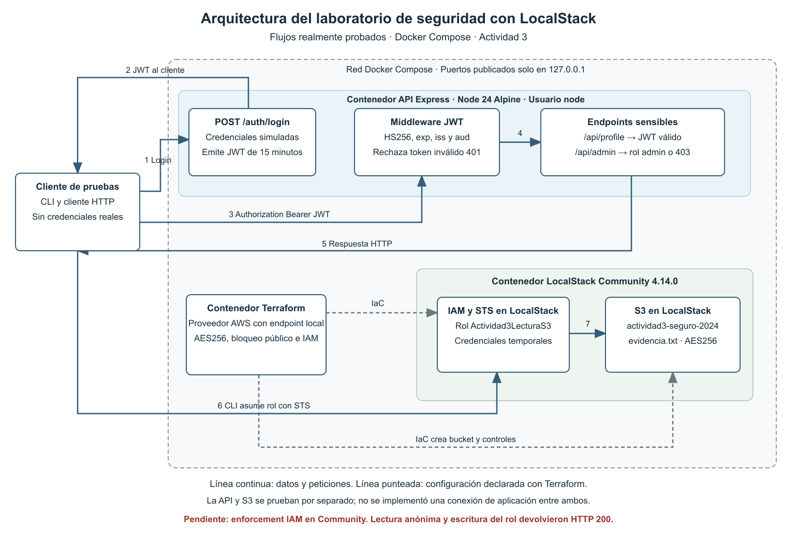

# Actividad 3 · Ciberseguridad con LocalStack

Laboratorio de infraestructura como código, protección de contenedores y autenticación JWT para la actividad **LSTI2318**. Utiliza LocalStack como entorno local compatible con servicios AWS y Docker Compose para la orquestación.

## Entrega

- [Reporte completo en PDF](docs/Reporte_Actividad3_LocalStack.pdf)
- [Reporte editable en Word](docs/Reporte_Actividad3_LocalStack.docx)
- [Diagrama de arquitectura](diagrama/arquitectura.png)
- [Diagrama editable en draw.io](diagrama/arquitectura.drawio)
- [Capturas de resultados](capturas/)
- [Registros y respuestas originales](evidence/)

## Alcance y resultados

| Apartado | Implementación y evidencia |
| --- | --- |
| Infraestructura | Terraform crea el bucket, cifrado AES256, cuatro controles de bloqueo público, propiedad de objetos, política del bucket, rol IAM y política de lectura. Siete recursos declarados. |
| Contenedores | Comparación de las bases Node 14 y Node 18 con Trivy; variante Node 18 corregida sin vulnerabilidades críticas; imagen final Node 24 sin detecciones en el análisis registrado. |
| API | Express y jsonwebtoken; validación de firma, algoritmo HS256, expiración, emisor y audiencia en `/api/profile` y `/api/admin`. |
| Autorización | El endpoint administrativo exige rol `admin`; los roles se asignan en el servidor y no se aceptan desde el cuerpo del login. |
| Pruebas | 13 de 13 casos JWT aprobados. Escaneo activo de OWASP ZAP completado con cinco alertas informativas. |
| IAM | JSON limitado a `s3:GetObject` sobre `evidencia.txt`; ejemplo aplicado con STS AssumeRole. |

### Limitación observada en LocalStack Community

La configuración de cifrado y bloqueo se almacena y puede consultarse, pero **no quedó demostrado el bloqueo efectivo de acceso** en LocalStack Community 4.14.0:

- `GetBucketPolicyStatus` devuelve una operación no implementada.
- Una lectura anónima del objeto devolvió HTTP 200.
- El rol con permiso de lectura pudo realizar `PutObject`, que debía rechazarse.

Estos resultados se conservan en el reporte y en los registros. No se presentan como pruebas aprobadas de aislamiento IAM. Para validar esos controles debe repetirse el laboratorio en un entorno con evaluación IAM activa y comprobar respuestas `AccessDenied` para las operaciones no autorizadas. El atributo AES256 emulado tampoco demuestra cifrado físico de los archivos del emulador en disco.

## Arquitectura



La API y S3 se verifican de forma independiente. El cliente de pruebas utiliza el proxy ZAP para las peticiones HTTP; el ejemplo S3 utiliza credenciales temporales de un rol obtenido mediante STS. Terraform configura los recursos emulados. No se implementó una conexión de aplicación entre la API y el bucket.

## Herramientas utilizadas

| Herramienta | Versión registrada |
| --- | --- |
| Docker Engine | 29.5.2 en Linux ARM64, con Colima |
| Docker Compose | 5.7.0 |
| LocalStack Community | 4.14.0 |
| Terraform | 1.14.9 |
| Proveedor AWS de Terraform | 5.100.0 |
| Trivy | 0.76.2 |
| OWASP ZAP | 2.17.0 |

La ejecución original se realizó el **10 de noviembre de 2026**, sobre `linux/arm64`. Las etiquetas de imágenes y bases de vulnerabilidades pueden cambiar. Los metadatos y las huellas de la sesión están en los reportes de Trivy y en [image-digests.txt](evidence/image-digests.txt).

## Requisitos

- Docker en ejecución.
- Docker Compose.
- Python 3.
- Acceso a internet para descargar imágenes, paquetes y la base de vulnerabilidades.
- Espacio suficiente para las imágenes y los reportes.

No se requiere una cuenta de AWS. El proveedor usa credenciales ficticias `test` y un endpoint dirigido exclusivamente a LocalStack. La edición Community incluida no necesita el token personal de LocalStack.

## Ejecución

```bash
git clone https://github.com/Skie1sr/actividad-3-ciberseguridad-localstack.git
cd actividad-3-ciberseguridad-localstack
python3 init_env.py
bash run_lab.sh
```

`init_env.py` genera `.env` con una clave JWT, contraseñas de las cuentas simuladas y una clave para la API de ZAP. El archivo se conserva localmente y está excluido del repositorio.

El script principal aplica Terraform, consulta S3 e IAM, construye las imágenes, ejecuta Trivy, inicia la API y ZAP y guarda las salidas en `evidence/` y `trivy/`. Las limitaciones de S3 e IAM se registran como hallazgos; no se sustituyen por resultados supuestos.

### Puertos locales

| Servicio | Dirección |
| --- | --- |
| LocalStack | `http://127.0.0.1:4566` |
| API | `http://127.0.0.1:3008` |
| Proxy y API de ZAP | `http://127.0.0.1:8089` |

Solo se publican en la interfaz local. Dentro de la red Docker, la API utiliza el puerto 3000 y LocalStack el 4566.

### Ejecución por fases

```bash
# Infraestructura
docker compose up -d localstack
docker compose run --rm terraform init
docker compose run --rm terraform validate
docker compose run --rm terraform apply -auto-approve
python3 verify_s3.py
python3 verify_iam.py

# API y pruebas
docker compose build api
docker compose up -d api zap
python3 run_api_tests.py
python3 run_zap_scan.py
python3 run_api_tests.py

# Verificación del estado declarado
docker compose run --rm terraform plan -detailed-exitcode

# Detener únicamente este laboratorio
docker compose stop localstack api zap
```

El escaneo autenticado añade temporalmente una cabecera de administrador mediante ZAP Replacer. No ejecutes la matriz negativa mientras esa regla esté activa. El script de escaneo la retira al finalizar correctamente; después se repite la matriz JWT.

## Estructura

```text
api/          API, dependencias y Dockerfiles
terraform/    Recursos IaC y bloqueo del proveedor
iam/          Política del rol, confianza y política del bucket
zap/          OpenAPI y política de escaneo API Minimal
trivy/        Reportes JSON de imágenes y aplicaciones
evidence/     Salidas de Terraform, S3, IAM, JWT y ZAP
capturas/     Cinco capturas de resultados
diagrama/     Arquitectura en PNG, SVG y draw.io
docs/         Reporte PDF y Word
compose.yaml  Servicios del laboratorio
run_lab.sh    Secuencia de ejecución
```

## Comparación de contenedores

| Imagen o variante | Críticas | Altas | Medias | Bajas | Sin clasificación | Total |
| --- | ---: | ---: | ---: | ---: | ---: | ---: |
| `node:14` | 23 | 568 | 735 | 122 | 4 | 1452 |
| `node:18` | 228 | 2441 | 6814 | 2720 | 106 | 12309 |
| `node:18-alpine` | 3 | 43 | 55 | 38 | 0 | 139 |
| API Node 18 corregida | 0 | 6 | 7 | 3 | 0 | 16 |
| API final Node 24 | 0 | 0 | 0 | 0 | 0 | 0 |

Los valores son ocurrencias vulnerabilidad-paquete, no CVE únicos. Las bases incluyen distribuciones y conjuntos de paquetes distintos; el total no mide exclusivamente la seguridad del runtime Node.js.

`api/Dockerfile.node18` usa Node 18 Alpine, actualiza `libcrypto3` y `libssl3` y elimina npm del entorno de ejecución. Conserva vulnerabilidades altas, medias y bajas, aunque no críticas. Node 18 está fuera de soporte y se mantiene como variante educativa. La imagen recomendada, `api/Dockerfile`, utiliza Node 24 Alpine y también actualiza zlib.

## Archivos principales de evidencia

- [Aplicación de Terraform](evidence/terraform-apply.log)
- [Validación S3](evidence/s3-validation.json)
- [Política IAM y ejemplo del rol](evidence/iam-validation.json)
- [Matriz JWT](evidence/api-tests.json)
- [Resumen de ZAP](evidence/zap-summary.json)
- [Reporte completo de ZAP](evidence/zap-report.html)
- [Comparación de Trivy](evidence/trivy-summary.json)

Las claves, contraseñas, tokens, sesiones de ZAP, cachés, imágenes exportadas y estado de Terraform no forman parte de la entrega. Los documentos JSON de IAM corresponden a la cuenta simulada `000000000000`.

## Referencias

- [LocalStack y Terraform](https://docs.localstack.cloud/aws/connecting/infrastructure-as-code/terraform/)
- [LocalStack IAM Policy Enforcement](https://docs.localstack.cloud/aws/developer-tools/security-testing/iam-policy-enforcement/)
- [Proveedor AWS de Terraform](https://registry.terraform.io/providers/hashicorp/aws/latest/docs)
- [Docker Compose](https://docs.docker.com/compose/)
- [Trivy](https://trivy.dev/docs/latest/target/container_image/)
- [jsonwebtoken](https://github.com/auth0/node-jsonwebtoken)
- [OWASP ZAP API Scan](https://www.zaproxy.org/docs/docker/api-scan/)
